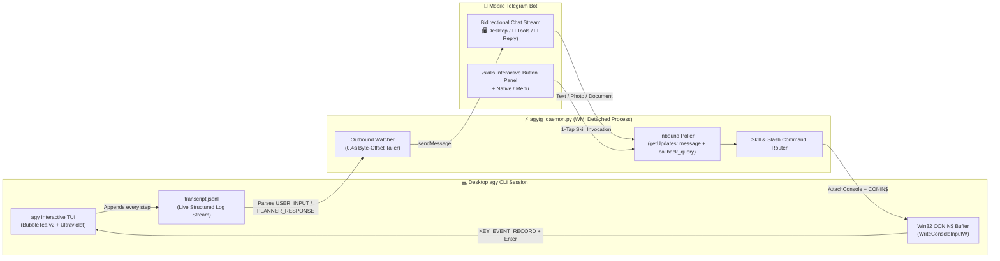

# `/agytg` — Bidirectional Telegram Remote Control for Google Antigravity (`agy`) CLI

> **Turn any Telegram Bot into a live, zero-intrusion wireless keyboard & synchronized display for your desktop `agy` CLI session (like Claude Code's `/rc`, built for Google Antigravity).**
>
> **把你的手機 Telegram Bot 變成桌機 `agy` CLI 視窗的「無線鍵盤與同步螢幕」——手機打字直接浮現在電腦終端機並自動送出；電腦上的思考、工具執行與回覆即時推播回手機。**

[](LICENSE)
[-green.svg)](https://www.python.org/)
[](https://learn.microsoft.com/en-us/windows/console/writeconsoleinput)

---

## ✨ Why `/agytg`? (為什麼做這個？)

Traditional CLI remote-control tools usually force a tradeoff:
1. **Headless Bot Spawners**: Starting a brand-new headless CLI process from Telegram means you can't see or continue the conversation that's already open on your desktop monitor.
2. **Web PTY Mirrors (xterm.js)**: Streaming a full desktop terminal UI into a tiny mobile browser screen makes text microscopic and typing painful.

**`/agytg` takes a third path — In-Place Session Takeover**:
- Type `/agytg` inside **any already-running desktop `agy` CLI session**.
- **Outbound (`agy` ➔ Telegram)**: Tails `transcript.jsonl` by byte offset, streaming clean Markdown messages for desktop prompts (`🖥`), tool calls (`🔧`), and assistant responses (`🤖`) without ANSI escape garbage.
- **Inbound (`Telegram` ➔ `agy` TUI)**: Uses Windows Console API (`AttachConsole` + `CreateFileW("CONIN$")` + `WriteConsoleInputW`) to inject `KEY_EVENT_RECORD` keystrokes directly into `agy.exe`'s console input buffer.
  - **Works even when the terminal window is minimized, unfocused, or the Windows lock screen is active!**
- **Zero External Dependencies**: Written purely with Python's standard library (`ctypes`, `urllib.request`, `json`). No `pip install` needed.

---

## 🏗 Architecture (系統架構)



---

## 🚀 1-Minute Quickstart (一分鐘快速安裝)

### Step 1: Create a Telegram Bot & Get Your User ID
1. Message **[@BotFather](https://t.me/BotFather)** on Telegram and send `/newbot` to get your `TELEGRAM_BOT_TOKEN`.
   > ⚠️ **Important (`409 Conflict` Prevention)**: Do not share a Bot Token that is already being polled (`getUpdates`) by another server. Use a dedicated bot for your desktop `agy` CLI.
2. Message **[@userinfobot](https://t.me/userinfobot)** on Telegram to get your numeric Telegram User ID (e.g. `123456789`).

### Step 2: Clone & Run the Installer
```powershell
git clone https://github.com/bingo-taiwan/agytg.git
cd agytg
.\install.ps1
```

### Step 3: Fill in `~/.gemini/agytg.env`
Open `$HOME\.gemini\agytg.env` and set your credentials:
```ini
TELEGRAM_BOT_TOKEN=1234567890:AAH_your_telegram_bot_token_here
ALLOWED_USERS=123456789
BOT_HANDLE=@your_agy_bot
```

### Step 4: Start `/agytg` inside any `agy` CLI Session!
In your desktop `agy` terminal, simply type:
```text
/agytg
```
Or run directly from PowerShell:
```powershell
python "$HOME\.gemini\config\skills\agytg\scripts\agytg_ctl.py" start
```

---

## 📱 Mobile Telegram Features (手機端功能一覽)

| Action on Telegram | What happens on Desktop `agy` CLI |
| :--- | :--- |
| **Send any text message** | Typed directly into the desktop `agy` input box and submitted with `Enter`. |
| **Send a photo or document** | Automatically downloaded to `%TEMP%\agytg\downloads\` and injected as `@<local_path> <caption>`. |
| **`/skills` or `/s`** | Pops up an interactive **Inline Keyboard panel** listing all skills installed in `~/.gemini/config/skills` & `~/.agents/skills` + native slash commands (`/compact`, `/plan`, `/boost`). |
| **Type `/` in Telegram** | Shows native Telegram autocomplete menu (`setMyCommands`) pre-populated with your local skills. |
| **`/compact`, `/plan`, `/goal`, `/boost`** | Injected as native `agy` slash commands (with automatic double-Enter to confirm the TUI autocomplete popup). |
| **`/<skill_name> <args>`** | Smartly translated into natural-language skill invocation (`Please use the <skill> skill: <args>`) so custom skills never get stuck in `agy`'s `/` popup menu. |
| **`/status`** | Displays live connection status, `agy.exe` PID, Session ID, uptime, and synced step count. |
| **`/esc`** | Sends `VK_ESCAPE` (`0x1B`) to the desktop `agy` console to interrupt/cancel a running generation. |
| **`/off` or `/stop`** | Cleanly terminates the background bridge daemon from your phone. |

---

## 🔧 Technical Highlights (關鍵技術細節)

### 1. Why `WriteConsoleInputW` instead of `SendInput`?
`user32.dll`'s `SendInput` requires the terminal window to have foreground focus and an unlocked desktop session. Because `agy` (built on Go's `charmbracelet/bubbletea` v2 + `charmbracelet/ultraviolet`) reads console input via `ReadConsoleInputW` on `CONIN$`, attaching directly to the console via `AttachConsole(agy_pid)` and writing `KEY_EVENT_RECORD` structs via `WriteConsoleInputW` bypasses GUI window focus completely.

### 2. Why spawn via WMI (`Win32_Process.Create`)?
When `agy` executes a tool call via `run_command`, it cleans up child processes in the tool's process group upon completion. `agytg_ctl.py` uses PowerShell's `Invoke-CimMethod -ClassName Win32_Process -MethodName Create` so `pythonw.exe` is spawned under `WmiPrvSE.exe`, surviving after the startup tool call exits.

---

## 📄 License

Released under the [MIT License](LICENSE).
